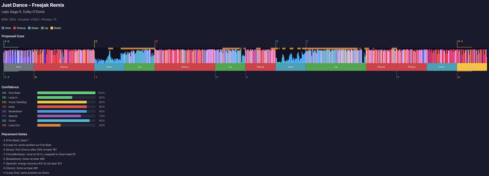

# djcues-studio

Automated hot cue and memory cue placement for rekordbox, tailored for **Industrial Techno, Hard Techno, Schranz, Hypnotic & Hard Groove, Bounce, Trance, and EDM** — based on phrase analysis (PSSI), vocal detection (PVDI), waveform bass energy, and a standardized cue strategy.

djcues-studio reads your rekordbox database, analyzes each track's phrase structure, waveform bass drops, and vocal content, proposes genre-personalized cue placements, and lets you review, adjust, and safely apply them back to the database (with interactive backup to your Documents folder).



## Installation & Schnellstart

### 1-Klick Setup & Start unter Windows
1. **Abhängigkeiten prüfen/installieren (optional):** Doppelklicke auf **`INSTALL_DEPENDENCIES.bat`** – prüft ob Python 3.10+ installiert ist (bietet ggf. direkte Installation über `winget` an), erstellt bei Bedarf die `.venv`-Umgebung und installiert alle benötigten Pakete (`pyrekordbox`, `click`, `djcues`, `pytest`).
2. **Studio starten:** Doppelklicke auf **`DJCUES_STUDIO.bat`** (oder **`start.bat`**). Sollte `.venv` oder ein Paket fehlen, wird automatisch zuerst die Einrichtung ausgeführt, bevor das **Walkthrough-Studio** (Genre -> Playlist -> Tracks -> Aktion) öffnet!

### Manuelle Installation
Erfordert Python 3.10+ und [uv](https://docs.astral.sh/uv/) oder pip:

```bash
# Mit uv:
uv sync
uv run djcues

# Oder mit venv:
python -m venv .venv
.\.venv\Scripts\activate
pip install -e .
python -m djcues.cli
```

## Cue System

djcues uses a standardized 8 hot cue + 8 memory cue system defined in `cue-system.csv`:

| Pad | Hot Cue | Color | Purpose |
|-----|---------|-------|---------|
| A | First Beat | Green | True start of the track |
| B | Bassline Introduction | Green | Start mixing when the bass enters |
| C | First Breakdown | Blue | First breakdown / buildup reference |
| D | 8 Beats Before Main Drop | Orange | Waypoint before the main drop |
| E | Main Breakdown | Blue | Start a second track for a double drop |
| F | 32 Beats Before Main Drop | Orange | Phrase-aligned mix/acapella waypoint |
| G | Main Drop | Red | Main energy peak |
| H | Final Drop / Outro | Blue | Final big moment / mix-out point |

Memory cues 3-7 are placed a configurable number of bars before their corresponding hot cue (default: 16 bars). Memory cues 1, 2, and 8 share the same position as their hot cue. The two pre-drop markers are exact beat-grid offsets: D is 8 beats before G and F is 32 beats before G. Colors are standardized per slot.

To customize the cue system, edit `cue-system.csv` and update the `CUE_SYSTEM` definition in `src/djcues/constants.py`.

## Usage

### Interactive terminal menu

Start `djcues` without a subcommand to open the guided terminal menu. It lets you choose proposal, comparison, visualization, browser review, and session apply without typing the full command. For the playlist-based actions, the menu then walks through **action → playlist → all tracks or one track → memory offset → loop length** with numbered choices. The explicit menu command is also available:

```bash
# Windows (empfohlen über djcues.bat / bestehende .venv):
djcues apply <session.json>
# oder Menü / Walkthrough öffnen:
djcues menu
# Alternative ohne Wrapper:
.\.venv\Scripts\python.exe -m djcues.cli menu
```

Use option **6** to exit the menu. The original command-line interface remains available for scripted use.

### Preview cues for a track

```bash
djcues propose "Playlist Name" "Track Name"
```

### Visualize with waveform, phrases, and vocal detection

```bash
# Single track
djcues viz "Playlist Name" "Track Name"

# Entire playlist
djcues viz "Playlist Name" --all

# Compare proposals against existing cues
djcues viz "Playlist Name" "Track Name" --compare
```

### Review and apply cues

```bash
# Launch interactive review in browser
djcues review "Playlist Name" --all

# Apply accepted cues to rekordbox (requires rekordbox to be closed)
djcues apply <session-file.json>

# Preview what would be written
djcues apply <session-file.json> --dry-run
```

In the review UI:
- **Accept** / **Skip** per track or use **Accept All**
- Click a cue marker to select it, then use arrow keys to nudge by 1 bar
- Press Delete to skip an individual cue
- Memory cues auto-recalculate when you adjust their hot cue

### Compare accuracy against curated tracks

```bash
djcues compare "Processed" --all
```

## How It Works

### Rekordbox 6/7 ANLZ parsing

Waveforms and phrase structures are decoded directly from the ANLZ tag framing instead of requiring the complete analysis file to be parsed successfully by one library schema. The visualizer supports the detailed color formats `PWV5` from `.EXT` files and `PWV7` from `.2EX` files, as well as `PWV3`, `PWV4`, and `PWV6` fallbacks. Phrase extraction has a corresponding raw `PSSI` fallback. This keeps tracks usable when Rekordbox writes a newer tag variant or when an unrelated analysis tag has an invalid length.

1. **Phrase analysis (PSSI)**: rekordbox analyzes tracks into phrases (Intro, Up, Down, Chorus, Outro). djcues maps these to cue slots using heuristics — e.g., Drop aligns with the first Chorus after 20% of the track.

2. **Vocal detection (PVDI)**: rekordbox's vocal detection data (stored in `.2EX` ANLZ files) provides per-frame vocal confidence. djcues uses the first strong vocal onset to place the Vocal/Buildup cue.

3. **ANLZ data (PSSI/PWV3–PWV7)**: Phrase structure and color/three-band waveform data are extracted from the available ANLZ variant and rendered in the HTML visualizer for visual reference.

4. **Beat grid**: All cue positions are snapped to the beat grid for precise alignment.

## Safety

- **Interactive Documents Backup**: Before applying any changes (`djcues apply`), you are always asked if you want to back up `master.db` (incl. `-wal`/`-shm` files) into **`Documents\rekordbox databse backup\<YYYY-MM-DD_HH-MM-SS>\`** (also available anytime via `djcues backup` or the menu)
- **Overwrite protection**: Tracks with existing cues require explicit confirmation
- **Rekordbox must be closed**: The apply command will not write while rekordbox is running
- **Read-only by default**: `propose`, `compare`, `viz`, and `review` never modify the database
- **DB-only writes**: Cues are written to `master.db` only (not ANLZ files). rekordbox handles ANLZ sync on USB export.

## Configuration

| Option | Default | Description |
|--------|---------|-------------|
| `--offset` | 16 | Memory cue offset in bars before hot cue (16 or 32 bars recommended for fast techno) |
| `--loop-bars` | 4 (auto 8) | Loop length in bars (automatically adapts to 8 bars for fast tempo >= 140 BPM) |

These are sane defaults for dance tracks, EDM, house, and fast underground techno.

### Industrial Techno & Hard Techno Intelligence (140–165+ BPM)

In fast-paced genres like **Industrial Techno, Hard Techno, Schranz, and Raw Groove (145–165 BPM)**:
- **Tempo-Adaptive Loops:** At 155 BPM, a 4-bar loop is only ~6.2 seconds (too short and repetitive). The engine automatically adapts to **8 bars** (~12.4s) at 140+ BPM for hypnotic, seamless looping.
- **Underground Mood 2 / Verse & Bridge Support:** Many techno tracks are analyzed by Rekordbox in Mood 2 (Verse 1–6 and Bridge) without an EDM "Chorus" tag. The engine intelligently identifies the main drop as the explosive energy peak bursting out of the deepest breakdown (Bridge/Down).
- **No-Overlap Protection:** Prevents Pad B (Bassline/Rumble) and Pad C (First Breakdown) from colliding on the same beat.
- **PSSI Fallback:** Tracks not yet analyzed for phrases in Rekordbox still receive mathematically sound, beat-grid aligned cue points (Bar 1, Bar 17/33 bass entry, 33% climax, 32-bar mix-out loop).

## Aktualisierungen & Changelog

Hier werden alle aktuellen und zukünftigen Neuerungen, Fehlerbehebungen und Optimierungen des Projekts dokumentiert.

### [2026-11-11 (v11)] — Fix für `.venv`-Konflikt unter Windows (`uv run` / `.python-version`)
- **🔧 Fix in [`format_apply_command`](src/djcues/review.py):** Das Review-Studio schlägt unter Windows jetzt **vorrangig die aktive `.venv`** (`.\.venv\Scripts\python.exe -m djcues.cli apply "..."`) vor statt `uv run`, selbst wenn `uv` im System installiert ist. Dadurch versucht `uv` nicht mehr, eine laufende `.venv` zu löschen oder downzugraden (`Zugriff verweigert / os error 5`).
- **🐍 `.python-version` entfernt:** Verhindert, dass `uv` bei bestehender Python-3.12-`.venv` (über `INSTALL_DEPENDENCIES.bat`) auf `CPython 3.10` zurückwechseln und `.venv\Lib` überschreiben will (`requires-python = ">=3.10"` gilt weiterhin über `pyproject.toml`).

### [2026-11-11 (v10)] — Auswahl für vorhandene Cues im Walkthrough (Überschreiben vs. Behalten)
- **🛡️ Schutz & Auswahl für vorhandene Hot/Memory Cues (`--existing ask|overwrite|skip`):**
  - Direkt im Walkthrough (Schritt 2 sowie jederzeit über *Einstellungen ändern* und beim Anwenden) kannst du festlegen, wie mit Tracks verfahren wird, die bereits Hot Cues oder Memory Cues in Rekordbox besitzen:
    1. **Nein — vorhandene Cues behalten (Tracks mit Cues überspringen):** Schützt bestehende Cues zuverlässig und schreibt nur auf Tracks ohne vorhandene Cues.
    2. **Ja — vorhandene Cues überschreiben:** Ersetzt alte Cues durch die neuen generierten Cues.
    3. **Jedes Mal beim Anwenden nachfragen:** Zeigt die Track-Liste mit vorhandenen vs. neuen Cues und fragt gezielt nach (**[1] Überschreiben**, **[2] Behalten/Überspringen**, **[3] Abbrechen**).
  - Auch direkt per CLI nutzbar: `djcues apply <session.json> --existing skip|overwrite|ask`.

### [2026-11-11 (v9)] — Auto-Backup Loop am Trackende (Rekordbox Active Loop)
- **🛡️ Auto-Loop am Ende als Backup (`--auto-end-loop`):**
  - Neue Option direkt im Walkthrough-Menü (unter *Hot Cue & Loop Einstellungen* sowie jederzeit im Einstellungs-Untermenü änderbar): **„Auto-Loop am Ende als Backup (Active Loop)“**.
  - Setzt automatisch einen roten **Rekordbox Active Memory Loop (`ActiveLoop = 1`)** im Outro am Ende des Tracks (sucht automatisch über die Waveform-Spektralanalyse den stabilsten Groove-Bereich im Outro, bzw. platziert ihn sicher vor dem Trackende).
  - Sobald der Playhead im CDJ oder Rekordbox diesen Punkt erreicht, springt der Track **vollautomatisch in die Endlosschleife**, damit dir beim Mixen nie die Musik ausgeht — funktioniert auch unabhängig davon, ob normale Loops deaktiviert wurden.

### [2026-11-11 (v8)] — Persistente Aktions-Schleife im Walkthrough
- **🔁 Nahtlos mehrere Aktionen nacheinander ausführen:**
  - Nach einer Aktion im Walkthrough (z. B. **Im Webbrowser visualisieren**) wirst du nicht mehr direkt ins Hauptmenü zurückgeworfen, sondern bleibst in deiner aktiven Auswahl (Genre, Hot Cues, Loops, Playlist).
  - Du kannst direkt die nächste Aktion wählen (z. B. **Terminal-Vorschläge** -> **Review-Studio öffnen** -> **Review-Session in Rekordbox anwenden** mit automatischer Erkennung der gerade erstellten Session-Datei) oder gezielt einzelne Einstellungen ändern.

### [2026-11-11 (v7)] — Flexible Hot Cue Anzahl (4 / 8 / 12 / 16) & Loops An/Aus
- **🔢 Auswahl der Hot Cue Anzahl (`--hot-cues 4|8|12|16`):**
  - **4 Hot Cues (Kompakt, Pads A–D):** Mappt automatisch die 4 wichtigsten Meilensteine (Start, Bassline/Rumble, Main Drop, Outro) auf die ersten 4 Pads.
  - **8 Hot Cues (Standard, Pads A–H):** Das klassische 8-Pad-System.
  - **12 oder 16 Hot Cues (Erweitert, Pads A–P):** Volle Rekordbox-6/7-Bank mit erweiterten Markern (16 Bars vor Drop, 2. Drop, 2. Breakdown, PVDI Vocal Hook, Mix-Out-Trigger, Safety-Loop).
- **🔁 Loops An/Aus (`--loops` / `--no-loops`):**
  - Wähle direkt im Walkthrough oder per Flag aus, ob automatisch **Loops** gesetzt werden sollen (z. B. Bassline-Intro & Outro) oder ausschließlich normale Cue-Punkte ohne Loops.
- **🐛 Fix für `pyrekordbox >= 0.5.0` DB-Schreibmodul (`DjmdCue`):**
  - Importpfad in [`writer.py`](src/djcues/writer.py) für aktuelle `pyrekordbox`-Versionen (`pyrekordbox.masterdb.DjmdCue`) aktualisiert.

### [2026-11-11 (v6)] — Rekordbox v6 & v7 Erkennung, Versionswahl & Manueller DB-Pfad
- **🎛️ Rekordbox 6 / 7 Auswahl im Studio:**
  - Erkennt automatisch alle installierten **Rekordbox 6 und Rekordbox 7** Versionen (auch auf anderen Laufwerken wie `D:\`, `K:\` oder über `options.json` / `rekordbox3.settings`).
  - Sind **beide Versionen (v6 und v7)** vorhanden, kannst du am Anfang des Walkthroughs oder jederzeit über **Menüpunkt 7** auswählen, welche Version/Datenbank genutzt werden soll.
  - Wird kein Verzeichnis automatisch gefunden (*„No Rekordbox v6/v7 directory found“*), bricht das Tool nicht mehr ab, sondern bietet dir direkt die Möglichkeit, **v6/v7** und den Pfad zu deiner **`master.db`** (auch per Drag & Drop) anzugeben.
- **🔧 Neue CLI-Optionen:** `--rb-version [6|7|auto]` und `--db-path <pfad>` für alle Befehle.

### [2026-11-11 (v5)] — 1-Klick Abhängigkeiten-Installer (`INSTALL_DEPENDENCIES.bat`) & Auto-Setup
- **📦 `INSTALL_DEPENDENCIES.bat`:**
  - Neue Setup-Batch-Datei für Windows: Prüft automatisch Python 3.10+ (mit optionaler Installation via `winget`), erstellt `.venv` bei Bedarf und installiert automatisch alle Abhängigkeiten (`pyrekordbox`, `click`, `djcues`, `pytest`).
- **🔄 Auto-Setup in `DJCUES_STUDIO.bat`:**
  - `DJCUES_STUDIO.bat` prüft vor jedem Start selbstständig, ob `.venv` und alle Pakete da sind, und stößt bei Bedarf automatisch `INSTALL_DEPENDENCIES.bat` an — echtes Plug & Play.

### [2026-11-11 (v4)] — Interaktives Rekordbox-Backup in Dokumente
- **🛡️ Interaktive Backup-Abfrage vor jeder DB-Änderung:**
  - Bevor Änderungen über `djcues apply` oder das Menü in die Rekordbox-Datenbank geschrieben werden, wird nun automatisch gefragt, ob vorher ein Backup erstellt werden soll.
  - Das Backup legt automatisch einen Ordner mit aktuellem Datum und Uhrzeit unter **`Dokumente\rekordbox databse backup\<JJJJ-MM-TT_HH-MM-SS>\`** an und sichert dort `master.db` (inkl. `-wal` & `-shm`-Dateien).
  - Außerdem steht jederzeit ein direkter Backup-Befehl (`djcues backup` bzw. Menüpunkt 5) zur Verfügung.

### [2026-11-11 (v3)] — Eigenes Schranz-Profil & Kritischer Rekordbox Waveform-Fix (`PMAI`)
- **⚡ Eigenes Profil: Schranz / Emotional Schranz (150–175 BPM):**
  - Speziell für modernen und Emotional Schranz optimiert (8-Takt-Loops bei hohen Geschwindigkeiten, maßgeschneiderte Labels wie *Schranz Kick / Loop Entry* und *Emotional / Vocal Breakdown*).
  - **Waveform-gestützte Breakdown-Erkennung:** Rekordbox markiert laute Vocal-/Synth-Breakdowns im Emotional Schranz oft als `Up` statt `Down`. Die Strategie erkennt solche kickfreien Breakdowns nun automatisch am Abfall der Bass-Energie in der Waveform (und an Übergängen zwischen Chorus-Blöcken), sodass Pad E (Main Breakdown) und Pad C zuverlässig sitzen.
- **🐛 Bugfix im Rekordbox ANLZ-Decoder (`PMAI` Header & Detail-Priorisierung):**
  - Echte Rekordbox-Analyse-Dateien starten mit dem Magic-Header `PMAI` (nicht `ANLZ`). Durch den vorherigen Fehler wurden beim Einlesen echter Tracks 0 Waveform-Punkte geladen! Jetzt werden alle 800 hochauflösenden Farb-/3-Band-Waveform-Punkte korrekt ausgelesen.
  - Statt `PWV3`, `PWV5` und `PWV4` fälschlich aneinanderzuhängen, wählt der Decoder nun sauber die beste Detail-Waveform (`PWV7 > PWV5 > PWV3 > PWV6 > PWV4`).

### [2026-11-10 (v2)] — Walkthrough-Studio & Genre-Personalisierung (Groove, Bounce, Trance)
- **🎛️ Walkthrough-Menü (`DJCUES_STUDIO.bat` & `start.bat`):**
  - Neuer interaktiver 4-Schritte-Walkthrough: **1. Genre auswählen** -> **2. Playlist auswählen** -> **3. Tracks (Alle oder Einzeltrack)** -> **4. Aktion wählen** (Browser-Visualisierung, Terminal-Vorschau, Review Studio oder Vergleich).
- **🎵 Erweiterte Genre-Personalisierung:**
  - **⛓️ Industrial Techno (145–165 BPM):** Verzerrte Kicks, Dark Rumbles, 8-Takt-Loops, 16-Takt-Memory-Offsets.
  - **🔨 Hard Techno / Schranz (150–165+ BPM):** Unbändiger Drive, Schranz-Drops, 8-Takt-Loops.
  - **🌀 Hypnotic Groove (136–144 BPM):** Polyrhythmische Modularklänge, **16-Takt-Loops** für 2-minütige nahtlose Blends, **32-Takt-Memory-Warnung**.
  - **🥁 Hard Groove (140–150 BPM):** Tribal 909 Funk & federnde Percussion-Rolls, 8-Takt-Loops, 16-Takt-Offsets.
  - **🦘 Bounce / Hard Bounce (142–155 BPM):** Offbeat-Basslines, Vocal Cuts, 8-Beat & 16-Beat Pre-Drop Waypoints.
  - **🌌 Trance / Hard Trance (138–148 BPM):** Epische emotionale Breakdowns, **16-Takt-Loops** & **32-Takt-Memory-Offsets** für klassische Trance-Phrasierung.
  - **🤖 Automatische BPM-Erkennung:** Wählt auf Wunsch das ideale Profil vollautomatisch anhand des gemessenen Tempos.

### [2026-11-10 (v1)] — Industrial & Hard Techno Core Engine + Windows & Performance Fixes
- **⚡ Tempo-adaptives Looping (140–165+ BPM):**
  - Für Tempi ab 140 BPM adaptieren Pad B (Rumble-Entry) und Pad H (Outro) automatisch auf **8-Takt-Loops** (~12,4 s bei 155 BPM).
- **🎯 Erweiterte Techno-Drop-Erkennung (Mood 2 Verse & Bridge):**
  - Rekordbox versieht viele Underground-Techno-Tracks mit Phrase *Mood 2 (Mid)* ohne „Chorus“-Tag. Die Erkennung identifiziert nun den wahren Drop nach dem tiefsten Breakdown (Bridge / Down).
- **🛡️ Kollisionsschutz Pad B & Pad C:**
  - Streng getrennte Platzierung von Pad B (Bassline/Rumble) und Pad C (First Breakdown) – keine Doppelbelegungen mehr.
- **📊 Intelligenter PSSI-Fallback:**
  - Tracks ohne vorherige Rekordbox-Phrasenanalyse erhalten nun automatisch mathematisch saubere, beatgrid-ausgerichtete Cue-Vorschläge.
- **🚀 Performance-Boost bei großen Playlists:**
  - Menüauswahl und Einzeltrack-Aufrufe lesen Metadaten direkt aus der Datenbank, anstatt vorab hunderte ANLZ-Dateien von der Festplatte zu parsen.
- **🪟 Windows- & UTF-8-Fixes:**
  - Der Pfad für `.2EX`-Vocal-Dateien erkennt nun automatisch Windows-Umgebungen (`%APPDATA%\Pioneer\rekordbox\share`).
  - Terminal-Ausgabe auf UTF-8 abgesichert.

<!-- Vorlage für zukünftige Updates:
### [JJJJ-MM-TT] — Titel der Aktualisierung
- **Bereich/Feature:** Beschreibung der Änderung...
-->

## Project Structure

```
src/djcues/
    models.py       # Data model (Track, CuePoint, Phrase, BeatGrid)
    constants.py    # PSSI mood tables, cue system definition, color maps
    db.py           # Rekordbox database reader
    strategy.py     # Cue placement heuristics
    viz.py          # HTML timeline visualizer
    review.py       # Interactive review HTML + session management
    server.py       # Local HTTP server for review sessions
    writer.py       # DB backup and cue writes
    cli.py          # Click CLI (propose, compare, viz, review, apply)
```

## License

BSD 3-Clause. See [LICENSE](LICENSE).

## Colophon

Under the hood, djcues leverages [pyrekordbox](https://pyrekordbox.readthedocs.io) to interact with the [Rekordbox](https://rekordbox.com) database. It also makes extensive use of [analysis files](https://pyrekordbox.readthedocs.io/en/latest/formats/anlz.html#) from Rekordbox. Other dependencies include [click](https://click.palletsprojects.com/en/stable/) and [pytest](https://docs.pytest.org/en/stable/).

This project was created in fleeting free moments with the help of [Claude Opus 4.6](https://www.anthropic.com/news/claude-opus-4-6) and [Superpowers](https://github.com/obra/superpowers).

### Cue-Farblegende

- **Rot:** Drop / größter Energiepunkt
- **Grün:** Intro / Mix-in / Start
- **Blau:** Breakdown oder Outro
- **Gelb/Orange:** Build-up / Vorbereitung
- **Lila:** Breakdown, Vocal oder spezielle Cue (Reservefarbe)
